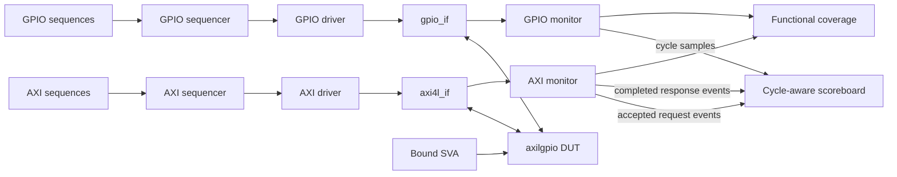

# AXI4-Lite GPIO UVM Verification

A SystemVerilog/UVM verification environment for the ZipCPU `axilgpio` AXI4-Lite GPIO peripheral. The project exercises independent AXI4-Lite channels, GPIO register semantics, synchronized inputs, sticky change detection, interrupt behavior, response backpressure, ordered pipelining, and reset recovery.

The current environment is a strong verification-development milestone, not a formal sign-off. It includes a self-checking reference model, protocol and functional assertions, functional coverage, directed and randomized tests, and a VCS/URG regression flow. Remaining closure items are documented below.

## Status at a glance

| Area | Current status |
|---|---|
| AXI4-Lite master agent | Active/passive UVM agent with independent AW/W timing, read traffic, response backpressure, and configurable ordered pipelining |
| GPIO agent | Active/passive stimulus and cycle-by-cycle observation |
| Reference model | Cycle-tagged model for GPIO output, input synchronization, `CHANGED`, `MASK`, `INT`, and registered `o_int` behavior |
| Checking | Request-acceptance prediction, read snapshots, ordered response matching, pin-level checking, reset flushing, and queue/credit audits |
| Assertions | AXI stability/response checks, reset checks, synchronizer checks, interrupt relation, W1C/sticky checks, and activation cover properties |
| Functional coverage | AXI request shape plus observed GPIO edge/output/interrupt coverage; the implemented groups reached 100% in the recorded run |
| Pipelining and stress | Configurable write/read credit depth; current stress runs use depths 2 and 3 and observe up to two outstanding requests on this DUT |
| RAL | Planned, not implemented |
| Formal sign-off | Not claimed; the `MASK` polarity conflict and coverage/parameter gaps remain open |

## DUT overview

The DUT is a 32-bit AXI4-Lite GPIO peripheral derived from the ZipCPU WB2AXIP project. The default testbench configuration is:

| Parameter | Value |
|---|---:|
| `C_AXI_ADDR_WIDTH` | 5 |
| `C_AXI_DATA_WIDTH` | 32 |
| `OPT_SKIDBUFFER` | 1 |
| `OPT_LOWPOWER` | 0 |
| `NOUT` | 30 |
| `NIN` | 5 |
| `DEFAULT_OUTPUT` | 0 |

With `NIN > 0`, the register map is:

| Address | Register | Access | Implemented behavior |
|---:|---|---|---|
| `0x00` | `LOAD` | RW / read alias | Replace strobed output bytes; reads return the current output |
| `0x04` | `SET` | RW / read alias | Set written output bits; reads return the current output |
| `0x08` | `CLEAR` | RW / read alias | Clear written output bits; reads return the current output |
| `0x0C` | `TOGGLE` | RW / read alias | Toggle written output bits; reads return the current output |
| `0x10` | `INPUT` | RO | Return the synchronized GPIO input |
| `0x14` | `CHANGED` | W1C | Sticky input-change status; a concurrent hardware change wins over software clear |
| `0x18` | `MASK` | RW | Interrupt-control bits; current RTL behavior is described in the open issue below |
| `0x1C` | `INT` | RO | Return the implemented active interrupt vector |

`WSTRB` is honored byte by byte. Address bits `[1:0]` are ignored, so unaligned addresses alias their containing 32-bit word. The DUT always returns AXI `OKAY`; it has no `SLVERR` or `DECERR` path. With `NIN=0`, the upper four word addresses alias the four output operations and `o_int` remains low.

## Verification architecture



The AXI monitor deliberately separates request acceptance from response completion:

- paired AW/W or accepted AR events drive state prediction and read-data snapshots;
- B/R completion events check response status, ordering, latency, and data;
- the GPIO monitor supplies a common cycle reference for input, output, interrupt, and reset checking.

This separation avoids predicting a write side effect at a delayed B handshake or comparing a read response against state that changed after AR acceptance.

### Main components

- `tb/axi_agent/`: reusable AXI4-Lite sequence item, sequencer, driver, monitor, interface, and agent.
- `tb/gpio_agent/`: reusable GPIO stimulus and observation agent.
- `tb/env/axi4l_gpio_scoreboard.sv`: cycle-aware reference model and ordered request/response checker.
- `tb/coverage/axi4l_gpio_coverage.sv`: accepted-transaction and observed-GPIO covergroups.
- `tb/assertions/`: bound AXI, reset, synchronizer, W1C, and interrupt assertions/covers.
- `tb/sequences/`: single-access, pipelined, mid-reset, and stress sequences.
- `tb/tests/`: smoke, v2 functional, closure, and v3 pipeline/reset/stress tests.

## What is checked today

### AXI4-Lite protocol and transport

- independent AW and W timing: same-cycle, AW-first, and W-first;
- VALID/payload stability while AW, W, AR, B, or R is stalled;
- ordered AW/W pairing and ordered B/R association without AXI IDs;
- response backpressure and request-side skid-buffer stalls;
- `OKAY` BRESP/RRESP checking;
- configurable pipelined driver credits and response queues;
- no lost, duplicated, or late response in the v3 stress audit;
- reset flushing of requests, pending responses, and credits.

### GPIO functionality

- `LOAD`, `SET`, `CLEAR`, and `TOGGLE` operations;
- byte-enable behavior, including `WSTRB=0` preservation;
- output alias reads and zeroing above `NOUT`;
- the digital `i_gpio -> q_gpio -> qq_gpio` sampling pipeline;
- rising/falling input changes and sticky `CHANGED` accumulation;
- W1C behavior, including deterministic same-cycle hardware-set/software-clear collisions;
- `MASK`, active interrupt bits, and the registered `o_int` relationship using the RTL's current polarity;
- writes to read-only `INPUT`/`INT` addresses do not directly change output or mask state.

Digital simulation checks the synchronizer's sampled behavior only. It does not prove metastability probability, MTBF, or capture of pulses shorter than a clock period.

## Test inventory

| Test | Purpose |
|---|---|
| `axi4l_smoke_test` | Baseline output operations, partial writes, aliases, and AW/W timing |
| `gpio_agent_smoke_test` | GPIO stimulus/monitor path smoke test |
| `axi4l_gpio_v2_directed_test` | Directed full-path GPIO input, `CHANGED`, W1C, mask, interrupt, and isolation checking |
| `axi4l_gpio_v2_random_test` | Seeded randomized AXI/GPIO functional traffic |
| `axi4l_gpio_bit34_coverage_test` | Directed rise/fall and sticky-status coverage for input bits 3 and 4 |
| `axi4l_gpio_w1c_hw_collision_test` | Deterministic same-bit W1C plus hardware-set collision on all implemented input bits |
| `axi4l_request_stall_test` | Deterministic AW/W/AR payload stability when DUT request buffering fills |
| `axi4l_v3_pipelined_test` | Ordered write/read overlap with delayed responses and AW/W order variations |
| `axi4l_v3_mid_reset_test` | Six reset-in-flight scenarios plus a checked post-reset recovery after each scenario |
| `axi4l_v3_stress_test` | 104-request pipeline/backpressure stress, read snapshots, FIFO ordering, credit accounting, and drain checks |

The mid-reset test covers a partial write, pending B response, pending R response, mixed read/write activity, credit wait, and reset after completed B/R boundaries.

## Running the project

### Requirements

- Linux shell environment
- GNU Make
- Synopsys VCS with UVM 1.2 support
- Synopsys URG for coverage reporting

The checked Makefile defaults to VCS `V-2023.12-SP1` under `/opt/Synopsys/vcs/V-2023.12-SP1`. Override `VCS_HOME` when the installation is elsewhere.

```bash
cd sim

# Baseline smoke test
make smoke

# Individual feature tests
make v2_directed
make v2_random
make v3_pipelined
make v3_mid_reset
make v3_stress

# Seven-test non-coverage regression
make regression

# Instrumented seven-test coverage run and URG report
make coverage
```

Example with a different VCS installation:

```bash
make coverage VCS_HOME=/path/to/synopsys/vcs/V-2023.12-SP1
```

Example custom test/seed:

```bash
make smoke RUN_OPTS="+UVM_TESTNAME=axi4l_gpio_v2_random_test \
  +UVM_VERBOSITY=UVM_LOW +ntb_random_seed=42"
```

The generated coverage dashboard is `sim/coverage_report/dashboard.html`.

### Regression versus coverage targets

The two Make targets are complementary:

- `make regression` runs smoke, GPIO smoke, v2 directed/random, v3 pipelined, v3 mid-reset, and v3 stress.
- `make coverage` runs v2 directed, v2 random with seed 1, bit 3/4 closure, W1C collision, request-stall closure, and v3 stress at configured depths 2 and 3.

## Recorded coverage snapshot

The repository contains the following URG report snapshot:

| Field | Recorded value |
|---|---|
| Date | 2026-10-29 22:47:54 |
| User | `ray` |
| Tool | VCS/URG `V-2023.12-SP1` |
| Command | `urg -dir coverage.vdb -report coverage_report` |
| Number of tests | 7 |

The seven instrumented runs are:

1. `axi4l_gpio_v2_directed_test`
2. `axi4l_gpio_v2_random_test` with seed 1
3. `axi4l_gpio_bit34_coverage_test`
4. `axi4l_gpio_w1c_hw_collision_test`
5. `axi4l_request_stall_test`
6. `axi4l_v3_stress_test` with depth 2
7. `axi4l_v3_stress_test` with depth 3

### Total coverage

| Score | Line | Condition | Toggle | FSM | Branch | Assert | Group |
|---:|---:|---:|---:|---:|---:|---:|---:|
| 89.13 | 91.88 | 80.95 | 82.19 | — | 82.52 | 97.26 | 100.00 |

### Hierarchical coverage

| Instance | Score | Line | Condition | Toggle | FSM | Branch | Assert |
|---|---:|---:|---:|---:|---:|---:|---:|
| `tb_top` | 87.51 | 91.88 | 80.95 | 82.19 | — | 82.52 | 100.00 |
| `uvm_pkg` | 33.33 | — | — | — | — | — | 33.33 |

### Module-definition coverage

| Score | Line | Condition | Toggle | FSM | Branch | Assert |
|---:|---:|---:|---:|---:|---:|---:|
| 90.19 | 94.07 | 88.57 | 81.99 | — | 89.04 | 97.26 |

URG did not report a scored FSM metric, so the blank field is shown as `—`; it must not be interpreted as 0% or 100%. The group score applies only to the two functional covergroups currently implemented. It does **not** mean that every item in `docs/coverage_plan.txt` is covered. Similarly, assertion coverage is an activation metric, not an assertion pass-rate percentage.

The report does not embed a Git revision or a complete parameter matrix. Treat these values as a reproducible project snapshot rather than formal sign-off evidence.

## Development evolution

The repository currently has one squashed Git commit (`0024177`, “Initial AXI4-Lite verification project”) and no release tags. The stages below are therefore reconstructed from the design notes, class names, and implemented tests; they are development milestones, not a claim of tag-by-tag Git history.

| Milestone | Main change |
|---|---|
| v1 smoke baseline | Reusable AXI and GPIO agents; independent AW/W driving; completed-transaction monitoring; output-operation model; smoke tests |
| v2 functional model | Split request/response monitor streams; cycle tags; request-time state prediction; AR-time read snapshots; cycle-by-cycle GPIO/input/interrupt model; directed/random tests; SVA and functional coverage |
| v3 pipelining | Configurable ordered pipelined mode, per-channel credits, independent request issue/response retirement, response queues, and an overlap proof test |
| v3.1 reset robustness | Mid-transaction reset injection, queue/credit flushing, aborted-transaction handling, and six post-reset recovery checks |
| v3.2 stress/closure milestone | Long depth-2/depth-3 runs, 104-request audit, simultaneous B/R stalls, snapshot-hold checking, deterministic W1C collision and request-stall closure tests, and the recorded URG merge |

The “v3.2” name is a project milestone used to describe the current stress/reset/pipelining state; it is not presently a Git tag.

## Repository layout

```text
.
├── dut/rtl/                 # DUT and skid-buffer RTL
├── original/zipcpu/         # Preserved upstream RTL copies
├── tb/
│   ├── axi_agent/           # AXI4-Lite UVM agent
│   ├── gpio_agent/          # GPIO UVM agent
│   ├── env/                 # Environment and scoreboard
│   ├── coverage/            # Functional covergroups
│   ├── assertions/          # Bound SVA
│   ├── sequences/           # Reusable stimulus sequences
│   ├── tests/               # UVM tests
│   ├── ral/                 # Reserved for future RAL work; currently empty
│   └── tb_top.sv            # Clock/reset, DUT, interfaces, and UVM startup
├── sim/
│   ├── Makefile             # VCS build, regression, and coverage targets
│   ├── filelist.f           # Compile order and include paths
│   └── coverage_report/     # Recorded URG HTML report
└── docs/                    # Plan, requirements, issues, traceability, and report template
```

## Known limitations and open issues

1. **`MASK` polarity is unresolved (`SPEC-MASK-001`).** DUT comments describe `1` as masking an interrupt, while the implemented expression is `r_mask & changed`, so `1` behaves as an enable. The scoreboard and SVA intentionally follow the RTL behavior until the design/specification owner resolves the conflict.
2. **Functional coverage is narrower than the plan.** The current two covergroups do not yet implement every cross and parameter item in `docs/coverage_plan.txt`; 100% group coverage is therefore not full plan closure.
3. **The recorded total score is below the planned 95% functional target.** Condition, toggle, and branch coverage also remain below the plan's initial 90%-per-code-metric target.
4. **Only the default DUT configuration is elaborated by `tb_top`.** `NIN/NOUT` boundaries, `NIN=0`, `OPT_SKIDBUFFER=0`, `OPT_LOWPOWER=1`, and alternate reset values still need an automated parameter matrix.
5. **RAL is not implemented.** The plan describes alias, volatile, and W1C modeling, but `tb/ral/` is currently empty.
6. **Stress depth 3 is configured but the present DUT run observes a maximum outstanding depth of 2.** This is still useful for credit and backpressure checking, but it is not evidence of three simultaneously accepted requests.
7. **External bus acceptance is currently used as the functional prediction point.** This is correct for the exercised paths, but an externally accepted non-zero side-effect write buffered behind a stalled response may execute later inside the DUT. A future internal commit observation or dedicated buffered-side-effect test should close this microarchitectural timing gap.
8. **Coverage evidence needs stronger provenance.** The report should record the Git commit, seed, complete parameter set, mask semantic mode, and pass/fail manifest in a machine-readable regression summary.
9. **Sign-off documents are not closed.** `docs/verification_report.md` remains a template, and plan/traceability statuses have not been updated to match all implemented tests.
10. **Repository hygiene needs cleanup.** Generated VCS executable/build artifacts are currently tracked even though they are listed in `.gitignore`; they should be removed from version control and regenerated locally.

## Roadmap

- Resolve `SPEC-MASK-001` in writing and align RTL comments, checks, and documentation.
- Expand functional coverage to the planned WSTRB/register, AW/W gap, backpressure, W1C, interrupt, reset-state, and occupancy crosses.
- Add automated parameter regressions for `NIN`, `NOUT`, skid-buffer, low-power, and default-output configurations.
- Observe the DUT's internal write-commit point, or add a bind-level commit event, for cycle-exact checking of buffered side-effect writes.
- Implement a UVM register model with explicit alias prediction and volatile/W1C handling.
- Add more randomized seeds, reset-in-stress scenarios, and coverage-directed closure tests.
- Review code/assertion exclusions and close or justify uncovered legal behavior.
- Generate a regression manifest containing commit, tool version, seed, parameters, test result, assertion summary, and coverage database name.
- Complete the traceability matrix and final verification report, then define formal sign-off criteria.
- Remove tracked simulator-generated artifacts and add CI/lint automation where licensed tools are available.

## Documentation

- `docs/spec_analysis.txt`: behavior extracted from the RTL and the open polarity conflict.
- `docs/verification_plan.txt`: scope, requirements, planned tests, assertions, coverage, and sign-off goals.
- `docs/coverage_plan.txt`: coverage intent and closure targets.
- `docs/traceability_matrix.csv`: requirement/test/assertion/coverage mapping.
- `docs/issues_log.csv`: authoritative open-issue list.
- `docs/version_explain.txt`: detailed v1 limitations and the architectural motivation for v2.
- `docs/verification_report.md`: final-report template; not yet a completed sign-off report.

## Provenance and licensing

`dut/rtl/axilgpio.v` and `dut/rtl/skidbuffer.v` originate from the ZipCPU WB2AXIP project and carry Apache License 2.0 notices in their source headers. The repository currently has no root `LICENSE` file covering the verification environment. Add an explicit project license and preserve all upstream notices before redistributing or accepting external contributions.

